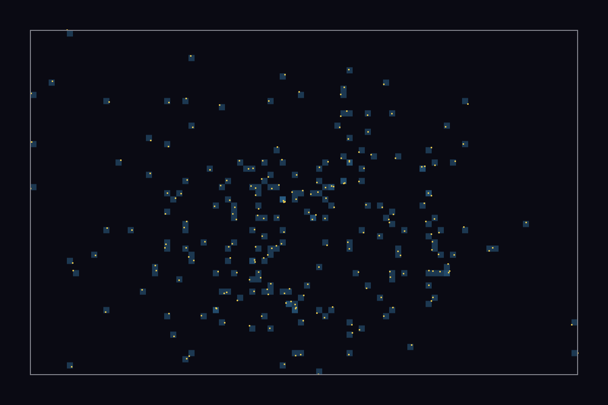

# Ecology

Ecology describes how discovered patterns distribute across parameter and behavior space. `LeniaCLI analyze ecology` exports the table this analysis runs on.

## Terms

- `parameter space`: the coordinate system induced by genotype parameters.
- `niche`: a dense region of parameter-behavior occupancy.
- `habitat`: practical synonym here for a region where similar behaviors persist.
- `edge of chaos`: the hypothesis that rich, diverse dynamics cluster near transition regions. This is a framing idea; the dossier has not tested it.

## The ecology export

`LeniaCLI analyze ecology` exports a deterministic parameter-space dataset from `compendium.sqlite` for analysis and plotting. It assigns no labels; it passes through whatever taxonomy and metrics the compendium holds.

Required:

- `--db` (`--db-path`): compendium SQLite path.

Optional:

- `--output` (default `outputs/ecology`): artifact directory.
- `--include-unstable`: include unstable creatures.
- `--limit <n>`: cap exported rows.
- `--plot`: write a `mu-sigma` scatter PNG.
- `--plot-width`, `--plot-height`: plot dimensions.
- `--pca`: compute PCA(2) on genotype vectors.
- `--pca-max-rows`: cap rows used for PCA.

The command fails if:

- `compendium_meta` or `creatures` is missing,
- the schema version differs from the current `compendiumSchemaVersion`,
- `creatures` is empty,
- PCA is requested with fewer than 2 usable rows,
- genotype vectors are inconsistent in length.

Output files are date-prefixed (`YYYY-MM-DD`):

- `<date>-ecology-embedding.jsonl`: one row per creature.
- `<date>-ecology-summary.json`: export metadata and output file paths.
- `<date>-ecology-pca2.jsonl` (with `--pca`): PCA coordinates.
- `<date>-ecology-mu-sigma.png` (with `--plot`): scatter plot.

Each embedding row contains:

- identity: `id`, `runId`, `isStable`, `score`.
- taxonomy passthrough: `taxonomyFamilyId`, `taxonomyGenusId`, `taxonomySpeciesId`. These are `null` until `LeniaCLI analyze taxonomy` has run on the compendium (see [Taxonomy](./Taxonomy.md)).
- genotype summaries:
  - `kernelCount`,
  - `muSigma` (`[mean(m), mean(s)]`),
  - `betaSummary` (`rMean`, `bMean`, `bMax`, `wMean`, `wMax`, `aMean`, `aMax`, `R`),
  - `genotypeVector` (canonicalized flattened kernel vector plus `R`).
- metrics subset: `massMean`, `gyration`, `centerVelocity`, `complexityMean`.

The plot is deliberately simple and deterministic: a histogram density overlay plus points, with no KDE dependency.

## The quality-gated corpus (2026-02-28)

A snapshot of the canonical `artifacts/compendium.sqlite` taken on 2026-02-28, at schema version `4`:

- indexed runs: `7`
- total indexed creatures: `224`
- stable creatures: `224`
- unique genotypes: `224` (unique/rows ratio `1.0000`)
- taxonomy-assigned rows: `0`, because the taxonomy command did not exist yet

Mu-sigma occupancy from that corpus (`LeniaCLI analyze ecology --plot`):

Each point is one indexed creature projected to:

- `mu`: mean kernel center value (`m`) across kernels,
- `sigma`: mean kernel width value (`s`) across kernels.

Slow, meandering exemplar frame:

The corpus has strong diversity within its regime (non-overlapping seed blocks, no duplicated genotypes), but it is a single-regime sample from NNEA-style search only. It supports fitting thresholds on a clean population, testing the export and PCA wiring, and grounding terminology with stable examples. It does not support multi-habitat niche mapping or claims about ecological bands across regimes, and its snapshot predates taxonomy.

## Not implemented

- automated niche labeling and naming,
- ecological maps grouped by taxonomy,
- causal tests for "edge of chaos" claims.

## Related docs

- [Morphology and morphometrics](./Morphology.md)
- [Taxonomy](./Taxonomy.md)
- [The compendium](../contracts/CompendiumSchema.md)
