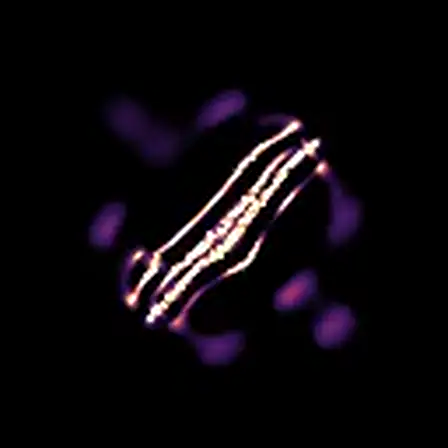

# Morphology and morphometrics

Morphology is the language for describing the structure and behavior of discovered patterns. Morphometrics are the subset of it that the indexer computes and stores.

## Examples from the corpus

Near-ballistic translational form:

Low-speed meandering form:

High-tortuosity meander from a motile run:

## Terms

- `symmetry`: coarse structural balance (for example bilateral versus radial appearance).
- `segmentation`: visibly repeated substructures.
- `swarm-like`: multiple granular mass clusters moving in coupled ways.
- `trajectory geometry`: how a pattern moves over time (straight, curved, looping, drifting).

Symmetry, segmentation and swarm are descriptive vocabulary only. Trajectory geometry is measured and indexed. A richer structural index (explicit symmetry classes, segmentation detectors, swarm decomposition) does not exist as indexed fields yet.

## Inputs

Available per creature:

- `SimulationMetrics` (path, displacement, mass stats, occupancy, energy, speed, gyration, center velocity, optional complexity).
- optional `ActivitySummary` time series (`speciesCount`, `diversity`, `eac`, `ean`) when activity JSONL is present, read from `overall/activity.jsonl` or `campaigns/*/activity.jsonl`.

## Stored morphometrics (v1)

The indexer computes morphometrics with `Morphometrics.from(...)` and writes them to `creatures.morphometrics_json` with method metadata:

- `morphometrics_method = "lenia-swarm:morphometrics"`
- `morphometrics_version = 1`

Fields:

- `pathTortuosity = pathLength / displacement` when `displacement > 1e-6`, else `null`.
- `movementEfficiency = displacement / pathLength` when `pathLength > 1e-6`, else `null`.
- `activitySpeciesMax = max(speciesCount)` when activity exists.
- `activitySpeciesStd = std(speciesCount)` when activity exists.
- `activityDiversityStd = std(diversity)` when activity exists.
- `activityEacMax = max(eac)` when activity exists.
- `activityEanMax = max(ean)` when activity exists.

If activity summaries are missing, all `activity*` fields are `null`.

## Reading the numbers

- low tortuosity and high efficiency mean directional transport,
- high tortuosity and low efficiency mean meandering or looping with little net displacement.

Anchored examples:

- `crossmap` seed `0`: `path/displacement=1.0026`.
- `nnea` seed `1`: `path/displacement=6.3610`.
- `motile` seed `8`: `path/displacement=22.2946`.

Caveats:

- `pathLength >= displacement` always holds.
- With only two samples, `pathLength == displacement` is expected and does not indicate a bug.
- Tortuosity distributions mean something only when recordings include enough temporal samples.

## Trait labels

Trait labels such as mover, wanderer, swarm or complex are not stored; the indexer stores raw morphometrics only. Motion-class names do appear in taxonomy family IDs (see [Taxonomy](./Taxonomy.md)). If trait labels become stored outputs, they must carry a trait method name, a trait version, and a threshold-set identifier.

## Related docs

- [Taxonomy](./Taxonomy.md), which builds family and genus IDs from these measurements.
- [Ecology](./Ecology.md), which exports them for parameter-space analysis with `LeniaCLI analyze ecology`.
- [The compendium](../contracts/CompendiumSchema.md), for where they are stored.
