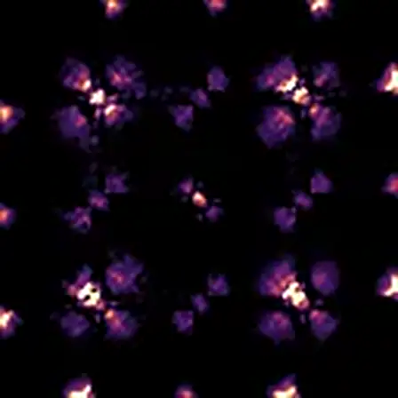
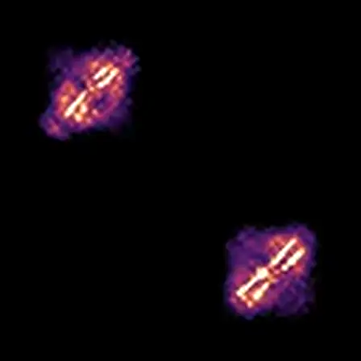

# Taxonomy

Taxonomy sorts the continuous variation in the compendium into families, genera and species. The indexer leaves taxonomy empty; a separate command, `LeniaCLI analyze taxonomy`, fills it in.

## Terms

- `species`: a locally continuous variation class where smooth morphing between members is possible.
- `genus`: nearby species with shared local structural or behavioral organization.
- `family`: a broader shared building-block style.
- `continuity`: absence of abrupt phase breaks along small parameter interpolations.

These are the concepts the IDs aim at. The assignment below approximates them with fixed thresholds; it does not yet test continuity between members.

## Assigning taxonomy

```bash
LeniaCLI analyze taxonomy --db <compendium.sqlite> [--stable-only] [--force]
```

- `--db` (`--db-path`): compendium SQLite path.
- `--stable-only`: assign only creatures with `is_stable = 1`.
- `--force`: overwrite rows that already carry taxonomy. Without it, any row with a family, genus or species ID is skipped.

The command fails unless `compendium_meta` exists and its schema version equals the current `compendiumSchemaVersion`. It writes all assignments in one transaction and prints how many creatures, families, genera and species it produced.

`ops/sweep.sh` runs it after each sweep, before `index backfill`, `index sanity` and `analyze ecology`. Re-indexing does not clear assigned taxonomy, because the indexer's upsert leaves the taxonomy columns untouched. `index sanity` reports stable creatures still missing taxonomy, and `publish atlas` refuses to run while any creature is pending unless given `--allow-pending-taxonomy`.

## The rules (method `lenia-swarm:taxonomy-heuristic`, version 1)

Each creature is classified from its genotype, `SimulationMetrics`, and morphometrics. Path tortuosity comes from morphometrics when present, otherwise from `pathLength / displacement` (or `0` when displacement is near zero).

Family, `fam-<motion>-<structure>`:

| Motion class | Rule on center velocity `v` and tortuosity `t` |
| --- | --- |
| `translator` | `v >= 0.008` |
| `glider` | `0.002 <= v < 0.008` and `t < 4` |
| `wanderer` | `0.002 <= v < 0.008` and `t >= 4` |
| `eddy` | `v < 0.002` and `t >= 8` |
| `drifter` | `v < 0.002` and `t < 8` |

Structure class by kernel count: `soliton` (one), `pair` (two), `triplet` (three), `polyform` (four or more).

Genus appends four bands to the family ID, joined by dots:

| Band | Cut points |
| --- | --- |
| speed | `speed-still` < 0.0005 <= `speed-slow` < 0.002 <= `speed-motile` < 0.006 <= `speed-fast` |
| path | `path-straight` < 1.5 <= `path-curved` < 4 <= `path-meander` < 10 <= `path-loop` |
| complexity (mean, `0` when absent) | `cx-low` < 0.05 <= `cx-mid` < 0.12 <= `cx-high` |
| mass (mean) | `mass-small` < 150 <= `mass-medium` < 400 <= `mass-large` |

Species appends a fingerprint of the genotype to the genus ID. The kernels are sorted into a canonical order so the fingerprint does not depend on kernel order, every value is rounded to three decimals, and the resulting vector is hashed with 64-bit FNV-1a.

`taxonomy_confidence` is a fixed value, `0.86` when morphometrics exist and `0.72` when tortuosity had to be computed from raw metrics. It records which inputs were available, not a measured fit.

## Before taxonomy existed

Before the command existed, grouping used measured proxies directly: motion regime (`center_velocity`), path geometry (`pathTortuosity`), and reproducible seed-level exemplars tied to media. The same two exemplars anchor the motion classes now:




The planned pipeline was to canonicalize the genotype, cluster into coarse families, refine into genus and species with continuity checks, and persist IDs with method and version provenance. The heuristic implements the first and last steps; it replaces clustering and continuity checks with fixed thresholds.

### ADR-001: taxonomy columns first, assignment later

Status: superseded by `LeniaCLI analyze taxonomy`.

The compendium gained taxonomy columns in schema v3, before any deterministic assignment existed. The decision was to keep the storage fields and write null taxonomy during indexing until a deterministic method was implemented, so that downstream schemas would not churn and unstable heuristics would not ship as if they were canonical. Its consequences still hold: consumers treat taxonomy fields as optional, every assignment carries method and version provenance, and assignment is a reproducible pass separate from indexing.

## Related docs

- [Morphology and morphometrics](./Morphology.md), for the measurements the rules read.
- [The compendium](../contracts/CompendiumSchema.md), for the taxonomy columns.
- [Ecology](./Ecology.md), whose export passes taxonomy IDs through.
